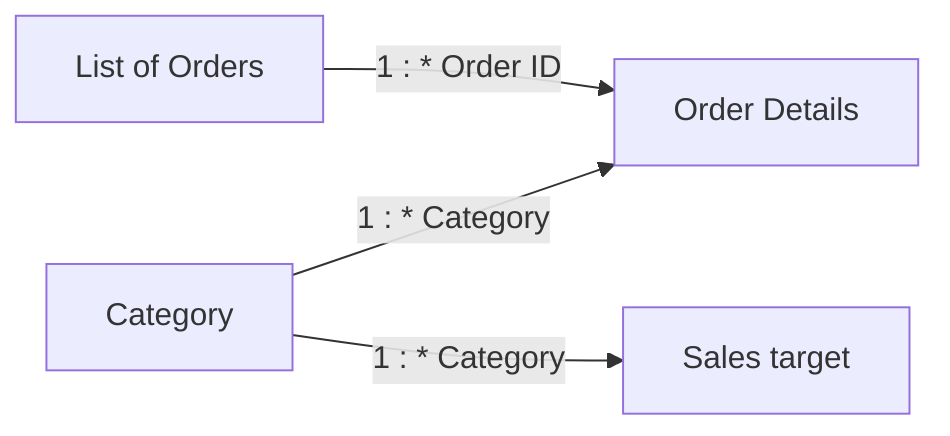

# 📊 Power BI 
### Data Transformation & Data Modeling · E-commerce Sales Dataset


**👤 Hariharakumar S.** &nbsp;|&nbsp; 🎓 Data Analytics (DA), Module 2

</div>

---

## 📌 Overview

This project prepares an **E-commerce sales dataset** for analysis using **Power BI Desktop** and **Power Query Editor**.
It covers the full pipeline: 📥 import → 🧹 clean → 🔗 merge → 📐 aggregate → 🗺️ model.

> 💡 **Goal:** build a consistent, accurate data model so any report built on it gives trustworthy numbers.

---

## 🗂️ Datasets

| 📁 File | 🔑 Key columns |
|---|---|
| `List of Orders.csv` | Order ID, Order Date, CustomerName, City, State |
| `Order Details.csv` | Order ID, Category, Sub-Category, Quantity, Amount, Profit |
| `Sales Target.csv` | Category, Month of Order Date, Target |

---

## 🛠️ What was done

### 1️⃣ Import & Transformation 🔄
- ✅ Imported all three files and opened them with **Transform Data**
- ✅ Limited **List of Orders** to the first **500 rows**
- ✅ **Order Date** → Date type · **Amount** and **Target** → Fixed decimal number 💲
- ✅ **CustomerName** → Proper Case ✍️
- ✅ **Location** = City + State merged with a comma delimiter 📍
- ✅ **Profit Margin** = Profit ÷ Amount, shown as a percentage 📈

**🏷️ Profit Status (conditional column)**

| Condition | Result |
|---|---|
| Profit < 0 | 🔴 Loss |
| Profit = 0 | 🟡 Break-Even |
| Profit > 0 | 🟢 Profit |

### 2️⃣ Merging 🔗
- Merged **List of Orders** + **Order Details** on `Order ID` using *Merge Queries as New*
- Output query name: **`Orders Data`**

### 3️⃣ Data Quality 🧪

#### ❓ Missing values
Column quality, distribution and profile were checked on every table.
All profiled columns: **✅ 100% valid · 0% empty · 0% error**

| Situation | Strategy |
|---|---|
| Missing Order ID, Order Date or Amount | 🗑️ Remove the record |
| Missing Quantity or Profit | 🔁 Replace with 0 |
| Missing optional descriptive text | 📌 Retain the null |
| `Profit = 0` | 🟡 Retain, since these are genuine Break-Even sales, not missing data |

#### 👯 Duplicates

> ### 🎯 Strategy: remove **exact duplicate rows only** · keep **repeated Order IDs**

One Order ID = **one customer's order**. Each line inside it records a different **Category, Sub-Category, Quantity and Amount** that the customer purchased.
So repeated Order IDs are **not duplicates**. They are the detailed purchase data the business needs, for example:

- 🛍️ which categories customers prefer (Electronics, Clothing, Furniture)
- 💰 what each product group contributes to sales and profit
- 👥 how many items each customer buys per order

⚠️ Removing rows by Order ID would delete real purchases and distort totals, averages and profit figures.

| Table | 🔍 Duplicate test | ⚙️ Action |
|---|---|---|
| List of Orders | Order ID alone | Remove duplicates if found |
| Order Details / Orders Data | All columns together | Remove only fully identical rows |
| Sales Target | Category + Month | Remove repeats |

### 4️⃣ Sorting & Filtering 🔎
- **Orders Data** sorted on **Order Date**
- Filtered to orders from **Tamil Nadu** 📍

### 5️⃣ Grouping & Aggregation 🧮
Each summary is built from a duplicate of its source table, so the originals stay untouched.

| 📋 Output table | 🧩 Group by | ➕ Aggregation |
|---|---|---|
| Count Of Order ID | Order ID | Count Rows |
| Average Profit by Category | Category | Average of Profit |
| Total Amount by Sub-Category | Sub-Category | Sum of Amount |
| Monthly Sales Target | Month of Order Date | Sum of Target |

### 6️⃣ Data Model 🗺️

A small **Category** bridge table (distinct categories only) links Order Details and Sales target.
Category repeats in both tables, so linking them directly would be many-to-many. The bridge gives clean **one-to-many** relationships. ✨



| 🔗 From (one) | ➡️ To (many) | 🔑 Column | Cardinality | Direction | Active |
|---|---|---|---|---|---|
| List of Orders | Order Details | Order ID | 1:* | Single | ✅ |
| Category | Order Details | Category | 1:* | Single | ✅ |
| Category | Sales target | Category | 1:* | Single | ✅ |

ℹ️ The aggregate tables are standalone summaries and are intentionally not related to the model.

---

## 🏆 Key Findings

| 🔎 Insight | 📊 Result |
|---|---|
| 🥇 Highest average profit per line | **Electronics** (34.07), vs Clothing (11.76) and Furniture (9.46) |
| 💎 Top sales by sub-category | **Printers** 58,252 · **Bookcases** 56,861 · **Saree** 53,511 |
| 📉 Lowest sales by sub-category | **Skirt** 1,946 · **Leggings** 2,106 · **Kurti** 3,361 |
| 🎯 Monthly targets | Rise from **31,400** (Apr-18) to **43,800** (Mar-19) |

---

## 📁 Repository Structure

```text
📦 powerbi-assignment-1
 ┣ 📜 PowerBI_Assignment1.pbix           ← Power BI file (queries, merges, model)
 ┣ 📄 PowerBI_Assignment1_Report.pdf     ← Report with screenshots + explanation
 ┣ 📂 data
 ┃ ┣ 📑 List of Orders.csv
 ┃ ┣ 📑 Order Details.csv
 ┃ ┗ 📑 Sales Target.csv
 ┣ 📂 screenshots                        ← Power Query + model view images
 ┗ 📘 README.md
```

> ✏️ Rename the `.pbix` file and adjust paths to match your repository.

---

## 🚀 How to Open

1. 💻 Install [Power BI Desktop](https://powerbi.microsoft.com/desktop/)
2. 📂 Open the `.pbix` file
3. 🔧 If prompted, update the source paths: **Home → Transform data → Data source settings** and point to the `data/` folder
4. 👀 Review **Applied Steps** in Power Query and the relationships in **Model view**

---

## 🎓 Skills Demonstrated


---

<div align="center">

⭐ **Thanks for visiting!** If this helped, consider giving the repo a star. ⭐

Made with 💙 by **Hariharakumar S.**

</div>
